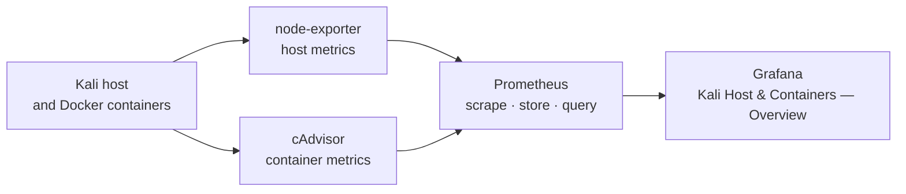

# Prometheus & Grafana Monitoring — Host and Container Metrics

Local monitoring for a Kali Linux Docker host: Prometheus collects host and container metrics, while Grafana presents them in an automatically provisioned overview dashboard.

## Architecture



Prometheus scrapes every 15 seconds. Its three configured jobs cover itself, node-exporter for host metrics, and cAdvisor for per-container metrics. Grafana receives Prometheus as its default provisioned data source and loads the included dashboard without manual import.

## Services and ports

| Service | Port | Purpose |
|---|---:|---|
| Grafana | 3000 | Dashboard and visualization interface |
| Prometheus | 9090 | Metrics storage, queries, target health, and alerts UI |
| node-exporter | 9100 | Host CPU, memory, filesystem, network, and uptime metrics |
| cAdvisor | 8080 | Docker container resource metrics |

## Repository layout

| Path | What it contains |
|---|---|
| `docker-compose.yml` | All four monitoring services and their local volumes |
| `prometheus/prometheus.yml` | Prometheus scrape configuration for Prometheus, node-exporter, and cAdvisor |
| `grafana/provisioning/datasources/datasource.yml` | Default Prometheus data source for Grafana |
| `grafana/provisioning/dashboards/dashboards.yml` | Grafana file-dashboard provider configuration |
| `grafana/dashboards/kali-overview.json` | Provisioned host and container overview dashboard |
| `verify.sh` | Checks Prometheus health, active targets, and Grafana health |

## Run it

Prerequisite: Docker and Docker Compose are installed, and ports 3000, 8080, 9090, and 9100 are available.

From the repository root:

```bash
docker-compose up -d
docker-compose ps
```

Wait briefly for the containers to start, then check Prometheus:

1. Open <http://localhost:9090> in a browser.
2. Go to **Status → Targets**.
3. Confirm the `prometheus`, `node-exporter`, and `cadvisor` targets are all **UP**.

Then open Grafana at <http://localhost:3000>:

1. Sign in with username `admin` and the Grafana default first-login password, `admin`.
2. When Grafana prompts for a new password, set a private password of your own. Do not store it in this repository, and never share or screenshot it.
3. Open **Dashboards** and select **Kali Host & Containers — Overview**. It is provisioned automatically; no JSON import is needed.

Anonymous access is not enabled, and Grafana sign-up is disabled.

## Dashboard contents

The provisioned dashboard includes:

- Host CPU usage percentage from `node_cpu_seconds_total`
- Host memory usage percentage from `node_memory_MemAvailable_bytes` and `node_memory_MemTotal_bytes`
- Root filesystem usage from `node_filesystem_size_bytes` and `node_filesystem_avail_bytes`
- Network receive and transmit rates from `node_network_receive_bytes_total` and `node_network_transmit_bytes_total`
- Host uptime from `node_boot_time_seconds`
- Container CPU usage from cAdvisor's `container_cpu_usage_seconds_total` for named containers

## Verify the stack

After the services have had a short time to scrape their targets, run:

```bash
bash verify.sh
```

A healthy run reports PASS for Prometheus health, at least three active Prometheus targets in the `up` state, and Grafana health.

## Expected results

- All four containers are running.
- Prometheus shows all three scrape targets as **UP**.
- Grafana opens on port 3000 and offers the provisioned Prometheus data source by default.
- The **Kali Host & Containers — Overview** dashboard appears automatically and begins displaying host and container panels.
- `bash verify.sh` finishes with three PASS results and no failures.

## Verified run

_Pending — this section will be completed with the real local run results, target status, dashboard screenshots, and verification output after the stack has been executed end to end._

## Cleanup

Stop and remove the monitoring containers and their Compose network with:

```bash
docker-compose down
```

This keeps the named Prometheus and Grafana data volumes. Add `-v` only when the stored local monitoring data and Grafana state should also be deleted:

```bash
docker-compose down -v
```
